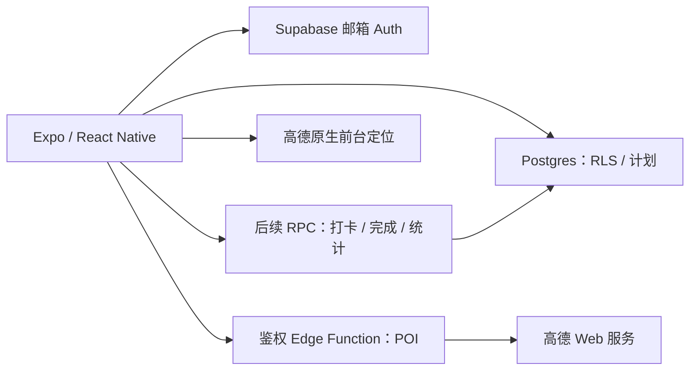

# 技术架构 v0.1

2026-10-21。既定栈不变；本文件区分已定方案、初始化验证和后续实现。
具体安装版本与通过的命令以 T01 回报 / lockfile 为证据，不能用选型文字代替验证。

## 1. 系统边界



- 客户端：周网格、表单、一次定位、围栏距离判断、手写总结和轻量统计展示。
- Auth / 数据库：邮箱密码、会话、本人数据隔离、唯一记录与有效状态约束。
- 后续 RPC：服务器时间判断、时长计算、幂等写入、补卡边界、完成状态更新。
- 后续 Edge Function：验证用户并代理 POI，隐藏 Web 服务 Key；不新建独立常驻后端。
- 管理：使用 Supabase Studio，不做第一周 Web 后台。

## 2. 客户端基础

- Expo + TypeScript strict + Expo Router；由实际官方模板初始化，保留仓库现有规范。
- Expo / React / React Native 与原生依赖采用匹配版本，提交 lockfile；以 npm ci 复现。
- T01 基础为 Expo58 / RN0.88 / React19.3；timegrid0.2.3/0.2.4有发布Context缺陷，已精确固定0.2.2并通过Web静态渲染与Android JS/Hermes导出，详见 ADR-012 和最终回报。
- 时间表优先实际验证 @symbiot.dev/react-native-timegrid；初始化不仅看 peer 范围，还要导入和打包。
- 高德原生候选 expo-gaode-map；核查插件入口、权限、Key 注入、SDK / 新架构要求。
- T05已接入Supabase官方JS客户端、AsyncStorage会话持久化、URL polyfill、邮箱Auth界面和AppState刷新管理；挂载后创建客户端以避免SSR触碰存储。SDK2.118使用内置刷新协调，不再添加deprecated processLock。
- 个人页面受会话边界保护：退出 / 切账号清空个人子树，旧请求通过scope失效；同账号正常刷新不重挂载或丢失编辑内容。T06个人数据请求需检查scope.isCurrent()后再回填。
- MVP 不引入全局状态框架、离线写队列或后台定位服务；先用组件状态 / 简单业务 hooks。

建议目录，按最终脚手架调整，不为占目录创建空抽象：

```text
app/                      Router 页面与布局
src/theme.ts              已实现的设计 token 与科目常量
src/components/           时间表、计划表单、状态组件
src/lib/                  Supabase、配置、时间 / 围栏纯函数
src/hooks/                计划、会话等真正复用的状态
supabase/migrations/      数据库迁移（唯一 SQL 来源）
supabase/functions/       后续 POI 代理等函数
docs/tasks/               子任务、回报、独立审查
```

## 3. 计划与打卡的数据流

1. 会话有效后按本周起止时间查询本人 plans；不默认请求全部历史。
2. 空白格给出当地日期和起始时刻，表单校验后写 plans；服务端约束兜底。
3. 未绑围栏的计划不请求位置；绑定后在用户点击打卡时请求一次前台位置。
4. 定位与 POI 坐标统一后客户端计算距离，范围内才允许进入实时打卡请求。
5. 后续 RPC 从 auth.uid() 取得用户，以服务器时刻校验窗口，生成唯一 checkin 和分钟数。
6. 重复提交返回已有结果或明确冲突，不能增加第二条；请求失败不显示成功。
7. 完成 / 总结通过后续原子操作写入；总结可选，空白不阻止直接完成，有内容时去首尾空白保存。
8. 统计从数据库有效记录计算，不用当前画面色块反推时长。

基础 Schema 先禁止客户端直接写 checkins。时间与总结规则已确认，最终 RPC 仍待后续任务实现；表存在不代表闭环已能写入。

## 4. 时间与统计合同

- start_at / end_at / checked_at 使用 timestamptz，以 UTC 传输。
- 第一周计划时间限制在所记录时区的08:00–23:00，和可见网格一致；表单与数据库均校验，避免隐藏计划。
- 沿用原 PRD 的设备本地时区；计划创建时保存 IANA 时区，避免补卡因设备旅行改变学习日。
- 打卡历史保留原计划科目和本地学习日期快照，后续编辑 / 删除不能把历史归到另一科目或日期。
- 以服务器时刻t判断：start_at−15分钟≤t≤start_at为normal，取完整计划分钟；start_at<t<end_at为late，取结束时刻减t的分钟并向下取整，无宽限；其余时刻不能实时打卡。
- 补卡归原计划学习日，不归提交日；七天是结束时间后的连续 168 小时，实现约定包括两端，见 PRD。总结同样可选。
- 科目时长累加有效 checkins 的分钟数，不重复计算计划时长。
- 完成率使用所选区间同一非删除计划集合：其中 completed 数 / 该集合总数，包含未来计划；删除同时排除分子分母，无计划显示“—”。
- 连续天数按学习日期去重；今天尚无记录时可从昨天起算，补卡可补齐原日期；不按登录时间计算。

## 5. 高德定位、选点与秘密

- 原生 SDK Key 和 Web 服务 Key 分开配置。原生 Key 绑定包名 / 签名，是原生包配置的一部分，不能当作服务器秘密。
- Web 服务 Key 仅在 Supabase Edge Function secrets，绝不使用 EXPO_PUBLIC_AMAP_WEB_KEY。
- POI 代理接受用户搜索词和可选城市 / 区域，验证 Supabase JWT 后调用固定高德端点。
- 后续实现限制参数长度、分页和超时，返回最少字段，处理限额 / 失败；不能变成任意 URL 代理。
- 高德国内 POI 与定位统一使用 GCJ-02。若返回 WGS-84，需显式转换或使用 SDK 一致模式；不能混算后声称 200m 正确。
- 距离用 Haversine，判定距离 ≤ radius。定位权限拒绝 / 超时 / 精度不足时提示重试，不伪造到达。
- 不保存实际用户位置、轨迹和离开事件，不申请后台位置权限。
- 围栏是自律工具；本版客户端判断可能被伪造，接受此边界，不扩展设备完整性或防作弊系统。

## 6. 邮箱 Auth 与账号

- 第一周邮箱 + 密码；不做手机号验证码。邮箱确认、发信限制、回调 scheme 按真实 Supabase 设置验证。
- 客户端使用项目 URL 与 publishable / anon Key，通过 RLS 授权；service_role / secret Key 只在服务端。
- 注册后的 profile 由数据库触发创建，避免客户端“注册成功但没有 profile”的半状态。
- 退出清会话及用户缓存；切换用户不能看到前一用户数据。过期会话和网络错误明确区分。
- 账号注销是后续需验证的受保护服务端操作；不把客户端删 profile 当作删除 Auth 用户。
- Agent 可自主创建 / 登录 / 配置项目，前提是具有真实身份资料与验证条件，不能虚报账号已完成。

## 7. 数据库与权限

- profiles、plans、checkins 均开启 RLS；显式 grants，禁止以 view 绕过本人隔离。
- checkins 对 (plan_id, user_id) 建同用户关联，并约束每计划唯一。
- plans 软删除隐藏于时间表；保留 checkins 和历史时长。真正账号删除按既定级联清理。
- 统计 view 使用 security_invoker；后续函数固定 search_path，验证 auth.uid() 与计划所有权。
- SQL / 本地stub验证与云端证据分开记录；T07已完成基础迁移的真实Auth / JWT / PostgREST双用户隔离11组验证，新增RPC仍需独立验收。
- T02 已交付基础迁移与验证脚本；准确命令和云端未测边界见 docs/database.md，docs/schema.sql 为受一致性检查的阅读副本。

## 8. 运行环境与部署

- 不需 Key 的基础页面必须能打开；未配 Supabase 时明确显示未配置，不发伪请求、不强制崩溃。
- 配置通过忽略的本地文件和平台环境注入，example 只列名称，不含真实值。
- Expo Go 可用范围由最终依赖决定；高德原生能力必须 development build 验证。
- Windows 可以做 JS / Android 工具链验证；本机不能编译 iOS，按条件用 EAS 和 Apple 签名。
- EAS projectId、Supabase project ref / 区域、部署 URL 和产物只有实际取得后才写 HANDOFF。
- 云迁移先在测试项目验证；不能对未知生产库直接覆盖 schema，也不销毁已有账号 / 数据来排错。

## 9. 性能、视觉与可访问性

- 不做自定义启动页 / 启动动画；原生系统必需的静态启动画面保持简洁，不能承诺完全取消系统画面。
- 进入应用尽快展示时间表结构；网络失败显示可操作状态，不让远程配置阻塞整个页面。
- “秒开”是待测体验目标，需在目标 Android / iOS 设备记录冷 / 热启动，不能凭 Web 截图声称达标。
- 颜色 / 字号 / 间距统一 token；计划文字在科目色上保证可读，状态不只用颜色区分。
- 触控目标、读屏标签、系统字体放大和减少动态效果按实际组件检查。

## 10. 验证顺序

1. 规范：引用、授权一致性、独立审查和 GitHub 前置提交（已完成 PR #1）。
2. 本地基础：干净安装、Expo 配置、lint / 类型、JS 打包、依赖证据。
3. 数据库：本地真实 PG 语义下约束、重复记录和两用户 RLS；明确测试 stub。
4. 真实服务：邮箱注册登录、JWT / RLS、POI 代理、真实 Key 与错误路径。
5. 原生设备：前台定位、GCJ-02、围栏内外、权限拒绝、实际构建安装。
6. 业务回归：时间端点、迟到 / 补卡、总结、三项统计与切用户隔离。

每层分别记录结果；前一层通过不代表后一层通过。完成阶段后更新 HANDOFF，保留仍缺的验证条件。
